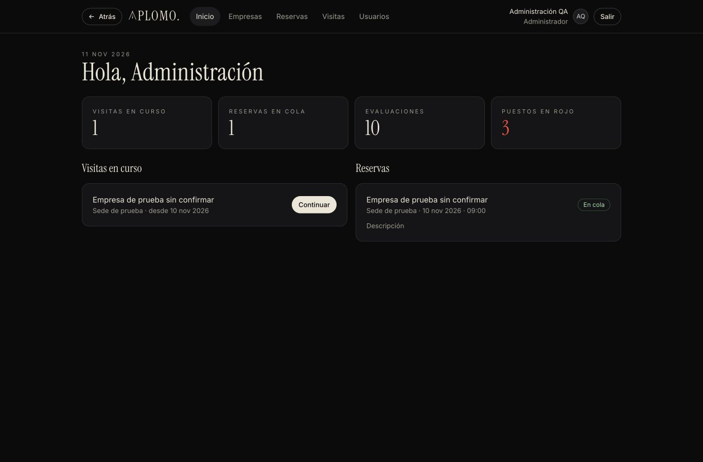
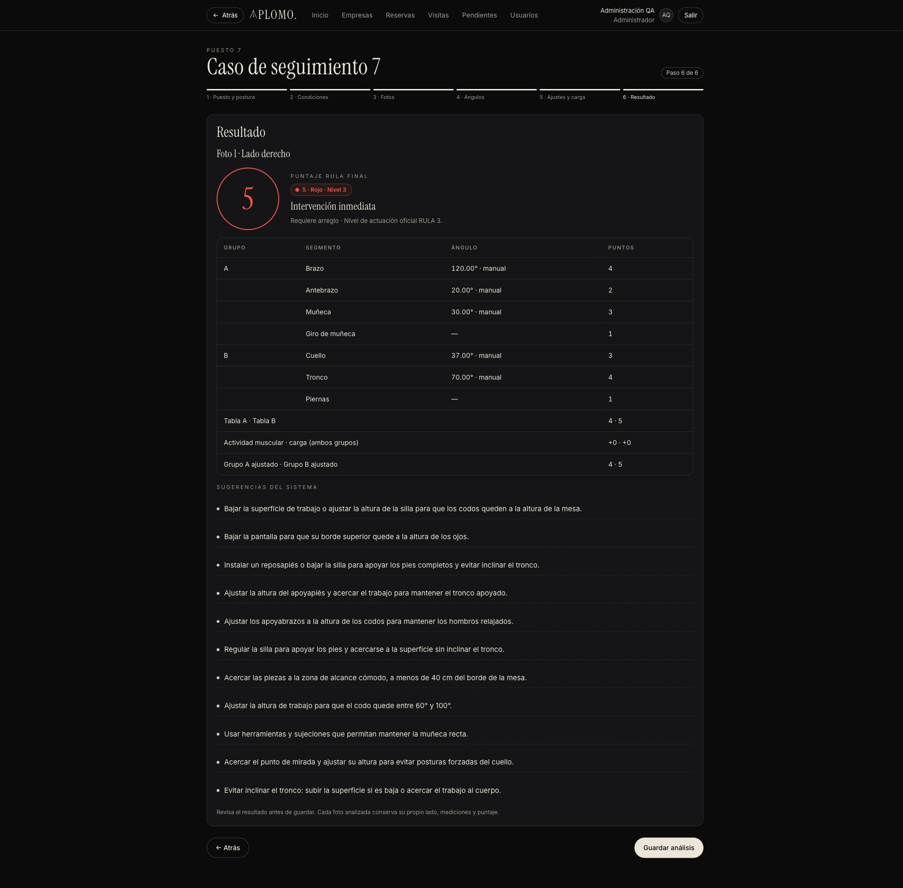
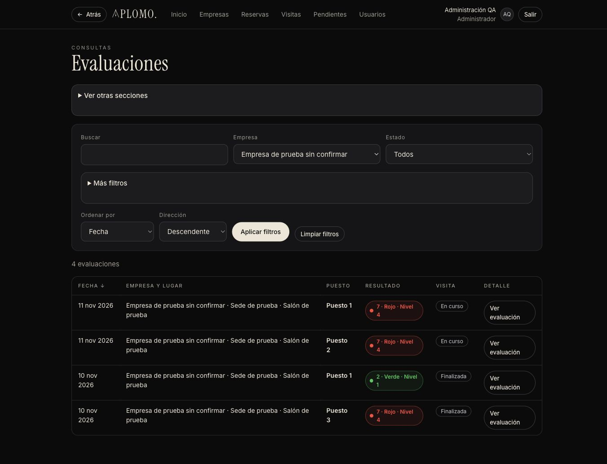

# APLOMO.

**Ergonomía con precisión.** Sistema web para evaluar posturas en puestos de trabajo con el método **RULA** (Rapid Upper Limb Assessment).

Proyecto Nuclear de Ingeniería de Software, 3.er semestre · Corporación Universitaria Empresarial Alexander von Humboldt · periodo 2026-2.


---

## Qué hace

El Ingeniero Industrial visita la empresa, toma fotos del puesto, marca los ángulos del cuerpo y APLOMO. calcula el puntaje RULA con su semáforo. Lo que sale en Rojo pasa a **pendientes de arreglo**, el sistema **propone mejoras** y la empresa consulta sus resultados desde su propia cuenta.

| Rol | Qué puede hacer |
|---|---|
| **Administrador** (Ingeniero Industrial) | Todo: cuentas, empresas, sedes, salones y puestos; reservas y visitas; evaluaciones con fotos, ángulos y puntaje RULA; pendientes; sugerencias; reevaluaciones; consultas. |
| **Usuario** (contacto de la empresa) | Inicia sesión, cambia su contraseña y **consulta** los datos de **su** empresa: reservas, resultados de visitas finalizadas, pendientes y sugerencias. Sin botones de crear ni editar, y nunca ve fotos. |

<p>
  
  
</p>
<p>
  
  
</p>

---

## Avance (hoja de ruta)

| Paso | Qué incluye | Estado |
|---|---|---|
| 0 | Proyecto, base de datos y estilo del prototipo | ✅ Hecho |
| 1 | Motor RULA (ángulos, tablas A, B y C, semáforo) con 389 pruebas | ✅ Hecho |
| 2–3 | Inicio de sesión, contraseñas seguras, bloqueo, inactividad, roles y cuentas | ✅ Hecho |
| 4–6 | Empresas, sedes, salones, puestos, reservas y visitas | ✅ Hecho |
| 7 | Evaluación: puesto y postura, condiciones, consentimiento y fotos | ✅ Hecho |
| 8 | Ángulos con 3 puntos, ajustes, carga y resultado RULA | ✅ Hecho |
| 9 | Pendientes de arreglo (puestos en Rojo) | ✅ Hecho |
| 10 | Sugerencias del sistema y seguimiento de mejoras | ✅ Hecho |
| 11 | Consultas: buscar, filtrar y ordenar en las 11 secciones | ✅ Hecho |
| 12 | Calificación de sedes y empresa + informe general en PDF | ✅ Hecho |
| 13 | Pulido final, prueba en Chrome, Edge y Firefox, datos de demostración | 🟡 13E-A aprobado y B implementado ([informe](docs/informe_paso13e.md)); C espera OK; QA físico / compatibilidad completa pendientes |
| 14 | (Opcional) Detección automática de puntos con IA | ✅ Implementado · pendiente de revisión |

**Entrega del PMV:** 27 de noviembre de 2026. Los informes de cada paso, con pruebas y capturas, están en [`docs/`](docs/) (`informe_paso7.md` a `informe_paso11.md`).

---

## Instalación rápida

Necesitas instalar **dos programas una sola vez**: **Java 21** y **MySQL 8**. Lo demás (Maven y las librerías) se descarga solo.

> Guía completa paso a paso, con solución de errores: **[INSTALAR.md](INSTALAR.md)**

### Mac

```bash
git clone https://github.com/Andybena2025/Aplomo-app.git
cd Aplomo-app
bash scripts/instalar_mac.sh     # solo la primera vez: Java 21 + MySQL
bash scripts/iniciar.sh          # crea la base (primera vez) y arranca
```

### Windows

1. Descarga el proyecto: botón verde **Code → Download ZIP** y descomprímelo (o `git clone`).
2. Doble clic en `scripts\instalar_windows.bat` (instala Java 21 y te guía para MySQL).
3. Doble clic en `scripts\iniciar.bat`.

Luego abre **http://localhost:8080** en Chrome, Edge o Firefox.

### Primer ingreso

| Correo | Contraseña temporal |
|---|---|
| `admin@rula.local` | `Cambiar2026` |

Al entrar, la app te pide cambiarla (mínimo 8 caracteres, con letras y números). Las cuentas de **Usuario** las crea el Administrador desde **Usuarios**.

---

## Tecnologías

Sin frameworks, como lo pide la guía del proyecto.

- **Java 17+** con el servidor HTTP del JDK (`com.sun.net.httpserver`)
- **MySQL 8** con JDBC y `PreparedStatement` (21 tablas, 3FN; tablas RULA y semáforo leídos de la base)
- **jBCrypt** para contraseñas (costo 10) · **JUnit 5** para pruebas
- **HTML, CSS y JavaScript puro**, con el estilo "Obsidian & Ivory" del prototipo
- **Maven** (incluido con `./mvnw`, no hace falta instalarlo)

## Pruebas

```bash
./mvnw test        # Windows: mvnw.cmd test
```

**783 pruebas aprobadas.** Usan una base aparte, `rula_ergonomia_pruebas`, nunca la real. Para crearla, mira la sección "Pruebas" de [INSTALAR.md](INSTALAR.md).

## Estructura

```
src/main/java/co/aplomo/   código Java (rula = cálculo RULA, servicio, dao, web, seguridad)
src/main/resources/static/ CSS, JavaScript e imágenes
src/test/java/             pruebas JUnit
docs/                      requisitos, método RULA, arquitectura, plan, informes y diagramas
docs/base_de_datos/        script MySQL, diccionario de datos y reglas de sugerencias
scripts/                   instalar e iniciar en Mac y Windows
config/                    db.properties.ejemplo (la copia real nunca se sube)
```

## Seguridad

Contraseñas con bcrypt, CSRF en cada formulario, consultas con `PreparedStatement`, permisos revisados en el servidor en cada petición, fotos privadas con nombre aleatorio y nada se borra de la base (se desactiva o se cancela).

## Prototipo

El prototipo interactivo que se presentó antes de programar sigue en línea: **https://andybena2025.github.io/Aplomo-Proyecto-Nuclear-/**

## Equipo

- Laura Gabriella Romero Gómez
- Johan Andrés Zapata Quintero
- Andrés Eduardo Benavides

Docente: Ing. Arle Morales Ortiz.

## Licencia

[MIT](LICENSE)
