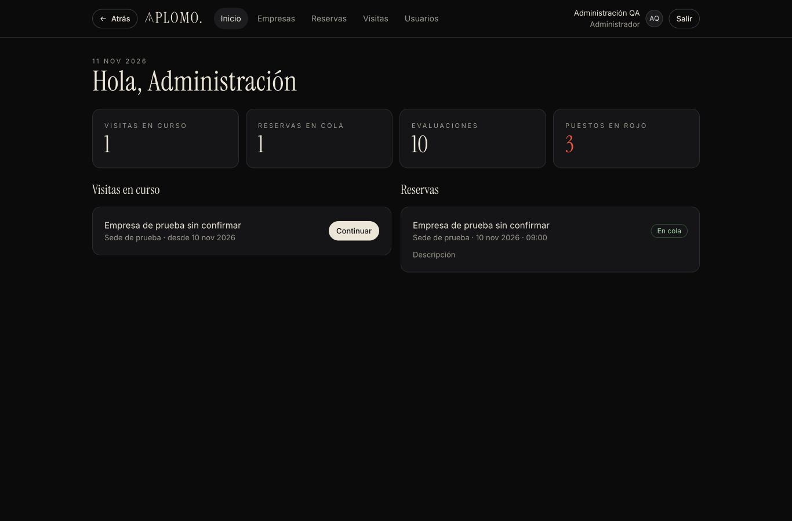
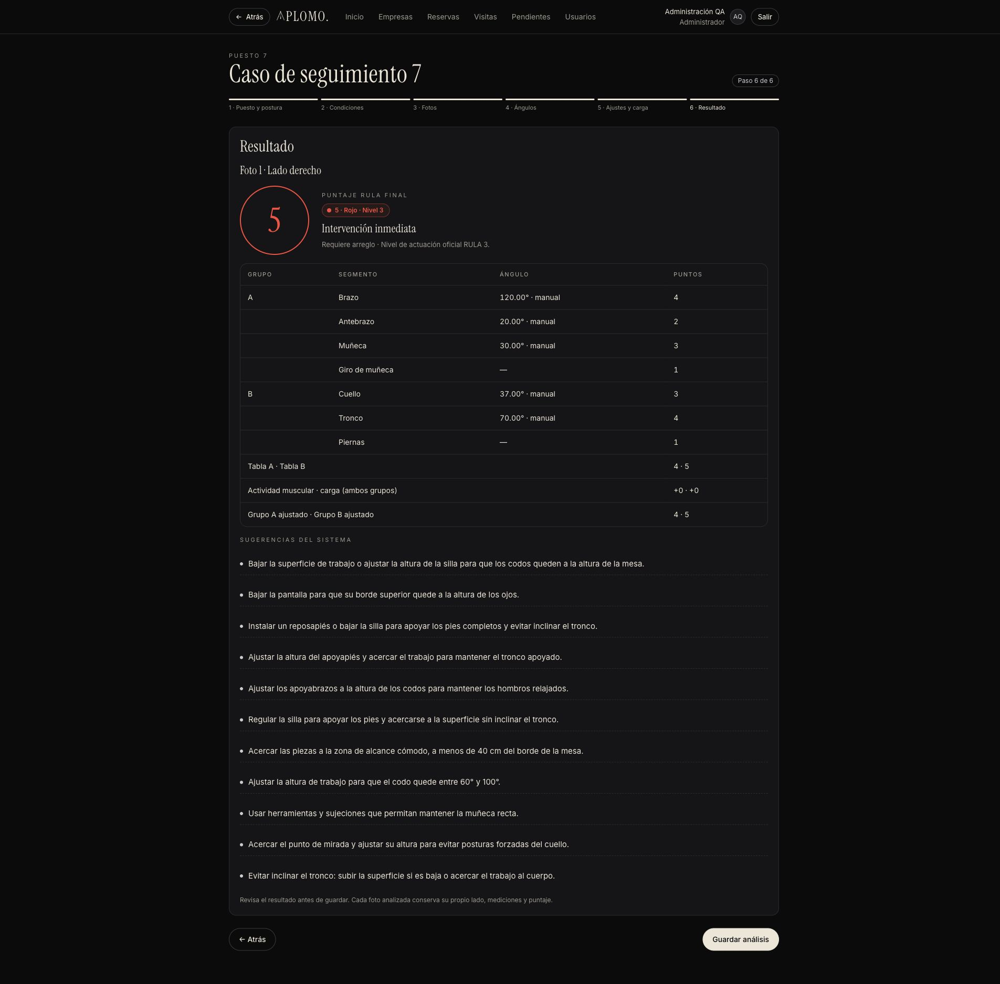
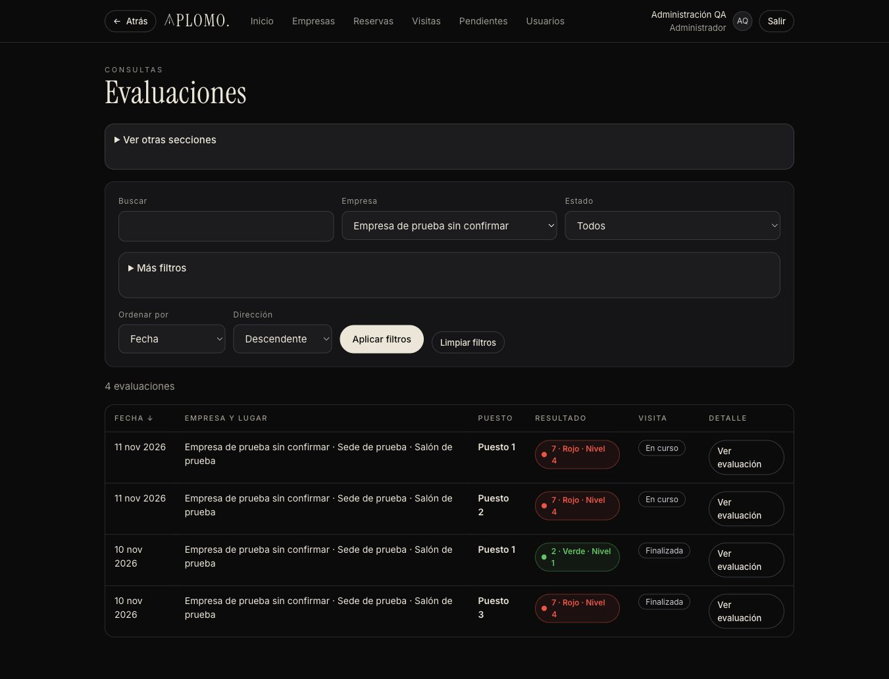

# ALINEO.

Antes se llamaba APLOMO.; el código interno conserva co.aplomo.

**Ergonomía con precisión.** Sistema web para evaluar posturas en puestos de trabajo con el método **RULA** (Rapid Upper Limb Assessment).

Proyecto Nuclear de Ingeniería de Software, 3.er semestre · Corporación Universitaria Empresarial Alexander von Humboldt · periodo 2026-2.


---

## Qué hace

El Ingeniero Industrial visita la empresa, toma fotos del puesto, marca los ángulos del cuerpo y ALINEO. calcula el puntaje RULA con su semáforo. Lo que sale en Rojo pasa a **pendientes de arreglo**, el sistema **propone mejoras** y la empresa consulta sus resultados desde su propia cuenta.

| Rol | Qué puede hacer |
|---|---|
| **Evaluador** (Ingeniero Industrial) | Trabajo de evaluación en las empresas asignadas, Mi agenda y Mis evaluaciones; sin crear empresas ni activar/desactivar. |
| **Administrador** (maestro) | Todo: cuentas, empresas, sedes, salones y puestos; reservas y visitas; evaluaciones con fotos, ángulos y puntaje RULA; pendientes; sugerencias; reevaluaciones; consultas. |
| **Usuario** (contacto de la empresa) | Inicia sesión, cambia su contraseña y **consulta** los datos de **sus empresas asignadas**: reservas, resultados de visitas finalizadas, pendientes y sugerencias. Sin botones de crear ni editar, y nunca ve fotos. |

<p>
  
  
</p>
<p>
  
  
</p>

---

## Avance (hoja de ruta)

| Paso | Qué incluye | Estado |
|---|---|---|
| 0 | Proyecto, base de datos y estilo del prototipo | ✅ Hecho |
| 1 | Motor RULA (ángulos, tablas A, B y C, semáforo) con 389 pruebas | ✅ Hecho |
| 2–3 | Inicio de sesión, contraseñas seguras, bloqueo, inactividad, roles y cuentas | ✅ Hecho |
| 4–6 | Empresas, sedes, salones, puestos, reservas y visitas | ✅ Hecho |
| 7 | Evaluación: puesto y postura, condiciones, consentimiento y fotos | ✅ Hecho |
| 8 | Ángulos con 3 puntos, ajustes, carga y resultado RULA | ✅ Hecho |
| 9 | Pendientes de arreglo (puestos en Rojo) | ✅ Hecho |
| 10 | Sugerencias del sistema y seguimiento de mejoras | ✅ Hecho |
| 11 | Consultas: buscar, filtrar y ordenar en las 11 secciones | ✅ Hecho |
| 12 | Calificación de sedes y empresa + informe general en PDF | ✅ Hecho |
| 13 | Pulido final, prueba en Chrome, Edge y Firefox, datos de demostración | 🟡 13G: contador estable, pantallas completas, demo lista y Evaluar ahora ([informe](docs/informe_paso13g.md)); revisión de Andy y QA físico / compatibilidad completa pendientes |
| 14 | Evaluación por revisión y detección automática de puntos | 🟡 Implementado; 842 pruebas y QA visual; prueba táctil iPad pendiente ([informe](docs/informe_paso14_revision.md)) |
| 15 | Evaluación como conversación guiada y detección con salida manual | 🟡 Flujo 15-D, login nuevo y práctica permanente implementados; iPad físico pendiente ([informe](docs/informe_paso15d.md)) |
| 17 | Práctica aislada, guía manual, demostración completa y pulido | 🟡 Implementado y verificado: 930 Maven + 72 JS; revisión de Andy e iPad físico pendientes ([informe](docs/informe_paso17.md)) |
| 18 | Galería por contexto, vista y lado; dirección por foto y postura 2 en Automático | 🟡 18B: S5 espejo solo como error; 943 Maven + 87 JS aprobadas; revisión de Andy e iPad físico pendientes ([informe](docs/informe_paso18.md)) |
| 19 | Docker: semillas, acceso, foto persistente, entorno y PORT | 🟡 Verificado; 948 Maven + 87 JS; revisión de Andy pendiente ([informe](docs/informe_paso19.md)) |
| 20 | Sugerencia de pies sin buen apoyo desde la foto de perfil | 🟡 20B: umbral 40 %, tres perfiles con MediaPipe real; 949 Maven + 104 JS; revisión de Andy pendiente ([informe](docs/informe_paso20.md)) |
| 22 | Portada móvil, acciones de tablas y herramienta privada de cuentas | 🟡 965 Maven + 110 JS; tamaños medidos y cuentas por servicio; revisión de Andy pendiente ([informe](docs/informe_paso22.md)) |
| 23 | Historial de inactivos, navegación Atrás y guía manual | ✅ Implementado y subido; [informe](docs/informe_paso23.md) |
| 24 | Tres roles, Mi agenda, Mis evaluaciones y notas | ✅ Implementado y subido; [informe](docs/informe_paso24.md) |
| 25 | ALINEO., Quiénes somos y Centro de ayuda | ✅ 1022 casos Maven verificados y 119 JS; [informe](docs/informe_paso25.md) |
| 26 | Calendario, Archivo, Mi cuenta, login compacto y demo del equipo | ✅ 1035 Maven verificados y 122 JS; [informe](docs/informe_paso26.md) |
| 26B | Código Java ordenado y prueba de 120 columnas con exclusiones explícitas | ✅ 1036 Maven y 122 JS; [informe](docs/informe_paso26b.md) |
| 27 | Sistema visual completo, propiedad de empresas y demo realista; avisos y solicitudes | ✅ 27A/B/C: 1090 Maven y 136 JS verificados; sistema visual, avisos y solicitudes; nueve cuentas activas ([informe](docs/informe_paso27.md)) |

| 28 | Pulido final: listas, demo, identidad y login | 🟡 28A: listas y correcciones; 1096 Maven y 138 JS verificados; B/C en curso ([informe](docs/informe_paso28.md)) |

**Entrega del PMV:** 27 de noviembre de 2026. Los informes de cada paso, con pruebas y capturas, están en [`docs/`](docs/) (`informe_paso7.md` a `informe_paso11.md`).

---

## Instalación rápida

Necesitas instalar **dos programas una sola vez**: **Java 21** y **MySQL 8**. Lo demás (Maven y las librerías) se descarga solo.

> Guía completa paso a paso, con solución de errores: **[INSTALAR.md](INSTALAR.md)**

### Mac

```bash
git clone https://github.com/Andybena2025/Aplomo-app.git
cd Aplomo-app
bash scripts/instalar_mac.sh     # solo la primera vez: Java 21 + MySQL
bash scripts/iniciar.sh          # crea la base (primera vez) y arranca
```

### Windows

1. Descarga el proyecto: botón verde **Code → Download ZIP** y descomprímelo (o `git clone`).
2. Doble clic en `scripts\instalar_windows.bat` (instala Java 21 y te guía para MySQL).
3. Doble clic en `scripts\iniciar.bat`.

Luego abre **http://localhost:8080** en Chrome, Edge o Firefox.

### Primer ingreso

| Correo | Contraseña temporal |
|---|---|
| `admin@rula.local` | `Cambiar2026` |

Al entrar, la app te pide cambiarla (mínimo 8 caracteres, con letras y números). Las cuentas de **Usuario** las crea el Administrador desde **Usuarios**.

---

## Probar la app sin ir a una empresa: fotos de prueba

Si vas a probar ALINEO. y no tienes un puesto de trabajo real a la mano, usa las **fotos de prueba** de la carpeta [`fotos_de_prueba/`](fotos_de_prueba/). Son imágenes **generadas con IA** (no son personas reales) de trabajadores en distintas posturas: de pie, inclinados, con los brazos arriba, levantando peso, etc. Sirven para recorrer la evaluación completa y ver cómo cambian los resultados según la postura.

- **11 fotos sueltas** de ejemplo (estación de pie, ensamble, bodega, laboratorio).
- **Galería de 5 posturas** en [`fotos_de_prueba/galeria/`](fotos_de_prueba/galeria/): cada una con **perfil, frente y detalle** del mismo momento.

**Cómo usarlas:** abre la foto en GitHub, guárdala en tu celular o computador, y en el paso **Fotos** de la evaluación elige "Sí, permite fotos" y súbela. Perfil y frente → **Para medir**; detalle → **De apoyo**. Luego toca **Detectar puntos** y revisa lo que propone la app.

La tabla de qué muestra cada foto y qué debería notar el evaluador está en [`fotos_de_prueba/LEEME.md`](fotos_de_prueba/LEEME.md). Es solo una guía: el puntaje real lo calcula la app según los puntos y las respuestas que tú confirmes.

---

## Tecnologías

Sin frameworks, como lo pide la guía del proyecto.

- **Java 17+** con el servidor HTTP del JDK (`com.sun.net.httpserver`)
- **MySQL 8** con JDBC y `PreparedStatement` (22 tablas, 3FN; tablas RULA y semáforo leídos de la base)
- **jBCrypt** para contraseñas (costo 10) · **JUnit 5** para pruebas
- **HTML, CSS y JavaScript puro**, con el estilo "Obsidian & Ivory" del prototipo
- **Maven** (incluido con `./mvnw`, no hace falta instalarlo)

Demo opcional lista para evaluar: Mac `bash scripts/cargar_demo.sh`; Windows `scripts\cargar_demo.bat`. Cada empresa trae Oficina/Planta, una visita En curso y resultados de los tres colores, con doce puestos de dos posturas en total. El cargador calcula los puntajes con el motor y copia sus fotos automáticamente. Primero cambia la contraseña temporal del Administrador.
Reinicio de desarrollo: Mac `bash scripts/reiniciar_demo.sh`; Windows `scripts\reiniciar_demo.bat`; exige administrador de MySQL y escribir `REINICIAR DEMO` antes de borrar solo las tres empresas DEMO-APLOMO.
Usa la base configurada; no crea bases ni cambia la configuración. Si hay cuentas vinculadas, cancela; las cuentas y otras empresas se conservan. Cierra la app antes de reiniciar y vuelve a abrirla después.

## Pruebas

```bash
./mvnw test        # Windows: mvnw.cmd test
```

**1096 pruebas Maven y 138 pruebas JS verificadas.** Usan una base aparte, `rula_ergonomia_pruebas`, nunca la real. Para crearla, mira la sección "Pruebas" de [INSTALAR.md](INSTALAR.md).

## Estructura

```
src/main/java/co/aplomo/   código Java (rula = cálculo RULA, servicio, dao, web, seguridad)
src/main/resources/static/ CSS, JavaScript e imágenes
src/test/java/             pruebas JUnit
docs/                      requisitos, método RULA, arquitectura, plan, informes y diagramas
docs/base_de_datos/        script MySQL, diccionario de datos y reglas de sugerencias
scripts/                   instalar e iniciar en Mac y Windows
config/                    db.properties.ejemplo (la copia real nunca se sube)
```

## Seguridad

Contraseñas con bcrypt, CSRF en cada formulario, consultas con `PreparedStatement`, permisos revisados en el servidor en cada petición, fotos privadas con nombre aleatorio y nada se borra de la base (se desactiva o se cancela).

## Prototipo

El prototipo interactivo que se presentó antes de programar sigue en línea: **https://andybena2025.github.io/Aplomo-Proyecto-Nuclear-/**

## Con Docker

Necesitas **Docker Desktop** instalado y abierto. No necesitas instalar Java ni MySQL. Desde la raíz del repositorio:

```sh
cp .env.ejemplo .env
```

Abre `.env` y cambia las dos claves de ejemplo por claves distintas. Ese archivo está ignorado por Git. Luego:

```sh
docker compose up --build -d
```

Abre **http://localhost:8080**. Cuenta inicial: **admin@rula.local**, contraseña temporal **Cambiar2026**; la app exige cambiarla en el primer ingreso. Es el Administrador de ALINEO, no el usuario root de MySQL. Si otra copia de ALINEO está usando 8080, detén esa copia antes de levantar Docker.

```sh
docker compose logs -f app
docker compose restart app
docker compose down
```

MySQL y las fotos se guardan en volúmenes con nombre; reiniciar o apagar con `down` los conserva. El SQL aprobado se ejecuta únicamente al inicializar un volumen vacío. La cuenta `app_rula` puede conectarse desde la red interna con SELECT, INSERT y UPDATE; no tiene DELETE. No se publica el puerto de MySQL en el equipo.

**Solo si quieres reiniciar desde cero:** `docker compose down -v` **borra los datos y las fotos de esos volúmenes**. No lo uses para actualizar la app.

La instalación sin Docker sigue igual: `bash scripts/iniciar.sh` en Mac o `scripts\iniciar.bat` en Windows. Las variables `APLOMO_DB_URL`, `APLOMO_DB_USUARIO`, `APLOMO_DB_CLAVE`, `APLOMO_PUERTO` y `APLOMO_CARPETA_FOTOS` permiten configurar la app; si faltan variables de conexión se conserva el respaldo de `config/db.properties`. Las sustituciones `-Daplomo.db.url`, `-Daplomo.puerto` y `-Daplomo.fotos` siguen disponibles, especialmente para aislar las pruebas.

### Demostración opcional en Docker

Primero inicia sesión y cambia la contraseña temporal del Administrador. Después carga el demo completo con el mismo motor y fotos que la instalación local:

```sh
docker compose --profile demo run --build --rm demo
```

La carga es voluntaria e idempotente: tres empresas ficticias, tres colores, doce puestos con dos posturas, fotos, pendientes, sugerencias, visitas Finalizadas y reservas futuras. Crea cuatro cuentas demo con contraseña temporal sin modificar cuentas existentes ni configuración. Las fotos se conservan en el volumen de la app. La empresa de práctica rápida es independiente y queda fuera de los contadores y consultas normales.


## Equipo

- Andrés Eduardo Benavides (Andy) — Diseñador UI y desarrollador
- Laura Gabriella Romero Gómez
- Johan Andrés Zapata Quintero

Proyecto Nuclear de Ingeniería de Software, Corporación Universitaria Empresarial Alexander von Humboldt, 2026-2

Docente: Ing. Arle Morales Ortiz.

## Licencia

[MIT](LICENSE)

## Tres roles · cambio Paso 24 (propuesta, Andy, 20 nov 2026)

- Administrador maestro: todas las empresas; único que crea empresas, administra cuentas, asigna empresas y activa/desactiva catálogos.
- Evaluador: trabajo completo en sus empresas asignadas (también historial inactivo), sin crear empresas ni activar/desactivar registros. Mi agenda y Mis evaluaciones; práctica privada.
- Usuario: consulta una o varias empresas asignadas; resultados solo de visitas Finalizadas y nunca fotos. Reservas en todos sus estados, sin editar.
- `cuenta_empresa` es la fuente de acceso. Quitar una asignación revoca el acceso en la siguiente petición. Una empresa admite un solo Evaluador activo. El historial de evaluaciones creadas por el Evaluador sigue disponible en solo lectura.
- RF-029 sigue fuera de alcance: no hay registro libre.
